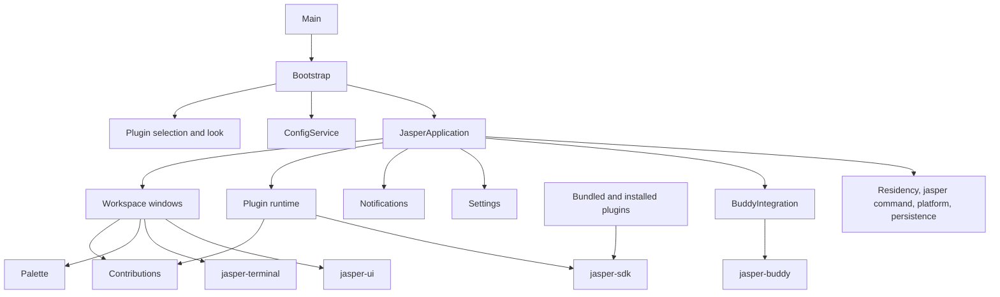

# Application architecture

`jasper-app` is the composition root of the Jasper workstation and the host of its plugins. It owns the workspace,
the terminal panes, commands, the command palette, notifications, Settings, themes, looks, residency and the `jasper`
command; most features arrive as plugins through the plugin runtime in `dev.jasper.app.plugins`. This guide records the
module boundaries, the process lifecycle, the threading rules and which package owns what. Recipes for changing them
are in [maintenance](app-maintenance.md); the plugin side is in [SDK architecture](sdk-architecture.md).

## Modules and boundaries



The diagram names the main collaborations; each package's `package-info.java` names its allowed outgoing
dependencies and its lifetime owner. `jasper-app` depends on `jasper-ui`, `jasper-terminal`, `jasper-buddy` and
`jasper-sdk`; none of them depends on the application. Plugins depend on the SDK and on the exported API packages of
the plugins they require, never on the application.

Bytecode checks in `check` enforce the boundaries:

| Check | Enforces |
| --- | --- |
| `verifyTerminalArchitecture` | The application uses only the terminal library's supported types: no `internal` package and no `TerminalSession.internalAccess()`. |
| `verifyApplicationArchitecture` | Only `Main` at the package root; only Buddy's `BuddyCompanion`, `BuddyNotice`, `BuddyNoticeId`, `BuddyOptions` and `BuddyPosition`; SDK types only in `dev.jasper.app.plugins`; `dock` JDK-only (from `java.awt` only `Rectangle` and `Point`); `vmoptions` JDK-only (plus `com.sun.management`); Buddy references only the JDK; acyclic application and Buddy package graphs; the supported Buddy types' public signatures carry only JDK and supported Buddy types. |
| `verifySdkArchitecture`, `verifyPluginArchitecture` | The SDK and testkit reference only the JDK and the SDK; a plugin references only the JDK, the SDK, its own packages, its bundled libraries and the exports of the plugins listed for it. |
| `verifyUiArchitecture` | `jasper-ui` depends on no other Jasper module, and its packages follow their listed edges. |

`AppDocumentationTest` also requires a `package-info.java` with Javadoc in every application, Buddy and SDK package.

## Design rules

- App classes are Java-public for collaboration between features; they are not a plugin API. The supported plugin API
  is `jasper-sdk`, and only `dev.jasper.app.plugins` may reference it. Do not infer SDK guarantees from Java
  visibility.
- No interface without two real implementations. The application's `PaletteScope` has `CommandsScope` and the adapter
  `HostedPalette` makes for each plugin scope; the file chooser's `ChooserSource` and `Browser` have the local disk and
  the plugin adapter; each look strategy (`MenuBarLayout`, `HeaderComposition`, `TabStrip`, `StatusCells`,
  `PaletteHome`, `StripeSet`, `PaletteView`) is a sealed interface with a default and a classic implementation.
- The command registry joins real Swing actions, their metadata, shortcuts and palette dispatch. The application's
  own commands outside the workspace, such as Manage Plugins…, the Help menu's items, Migrate Config, the `jasper`
  command's install and uninstall, Run Garbage Collection and Notifications: Show Errors, are registered in the
  `Contributions` model as a plugin's are, so they reach the palette, the menus and the Keymap in the same way.
- Immutable configuration builders preserve every untouched field. Concrete coordinators own start-up, session
  admission and shutdown. Typed workspace events and JDK callbacks report upward without back-references to the
  facade. Buddy has one facade over its bounded model and lazy windows.

## Start-up

```mermaid
sequenceDiagram
  participant Bootstrap as ApplicationBootstrap
  participant Selection as PluginSelection
  participant Config as ConfigService
  participant App as JasperApplication
  participant Runtime as PluginRuntime
  participant Window as TerminalWindow
  Bootstrap->>Bootstrap: Parse arguments, try the resident handoff (before AWT)
  Bootstrap->>Selection: Open the log, plugin maintenance, choose plugins and look
  Bootstrap->>Config: Read config.toml with the look's defaults
  Bootstrap->>Bootstrap: Desktop properties, title-bar style, splash; post EDT composition
  Bootstrap->>App: Compose on the EDT: theme and kit, notifications, Buddy, configuration
  App->>Runtime: Start plugins once, before any window
  Bootstrap->>Bootstrap: Bind the command socket, then the handoff endpoint when resident
  App->>Window: First window, warm-up (--background) or none (--no-window)
```

1. `Main.main` calls `ApplicationBootstrap.main`, which marks `MAIN_ENTERED` and parses `AppArguments`. An argument
   error prints the message and the usage and exits with status 2; `--help` prints the usage and exits 0. Nothing has
   touched AWT yet.
2. `AppDirs` resolves Jasper home (`jasper.home`, then `JASPER_HOME`, then the operating system's default). A launch
   that is not `--background`, `--no-window` or standalone sends its request to a resident Jasper
   (`HandoffSocket.handOff`) and exits 0 when it is accepted, without opening the log or the toolkit; on Windows it
   first lends the resident the foreground right, using the process id the resident records beside its token
   (`daemon/token.pid`, written on every platform). A `--background` launch exits while another process owns the
   handoff endpoint, and a `--no-window` launch exits while another Jasper serves the home's command socket.
3. The pre-pass runs on the bootstrap thread: it opens the log (`AppLog`), carries out pending plugin removals and
   installs (`JasperApplication.preparePlugins`, `PluginRuntime.maintain`) and builds the `PluginSelection`, which
   discovers plugins once, reads `plugins.toml` and the look attempt record, resolves the plugin set and elects at most
   one look, whose kit file it parses. The selection feeds the configuration's look defaults, the application and the
   runtime, so all three see the same plugin set.
4. `ConfigService` reads `config.toml` (or the `--config` file) with the look's defaults (`DefaultSource`).
5. `prepareDesktop` installs the shutdown hook (`jasper-log-shutdown`) and the uncaught-exception handler, commits the
   desktop properties and the title-bar style from the look's `DesktopFlags`, opens a branded look's splash
   (`splash`), prepares the built-in icons and posts the composition to the EDT.
6. On the EDT the bootstrap composes the application inside `StartupResources`: the palette's command recents
   (`CommandHistory`), then `JasperApplication`, whose constructor registers the bundled fonts and the look's faces,
   installs the theme under the look's kit (falling back to the standard look when the kit is at fault), and builds
   the notification center, Buddy, the configuration controller, the shell-profile catalog and the desktop's
   application handlers (quit, reopen, preferences, about). `createApplication` then wires the resident control, the
   resident indicator, the system notifier and the macOS Dock control, calls `startPlugins`, and binds the `jasper`
   command socket after the plugins, so a call that arrives first finds its handler. `startPlugins` builds the auxiliary windows, the Errors and About windows, the
   plugin runtime, the application's own contributions and the Settings dialog, and starts every selected plugin.
7. `compose` then gives a non-standalone launch its login-item reconciler, binds the handoff endpoint when this launch
   takes the resident role, and presents: the first window, the `--background` warm-up, or, for `--no-window`, serving
   the command socket.

`StartupResources` owns every acquired resource until `transfer()`, and on failure closes them once in reverse
acquisition order, suppressing cleanup failures onto the original error. The pre-EDT and EDT compositions use separate
scopes. A splash that is already showing closes when start-up fails.

Work that is not needed for the first window waits until start-up settles. The macOS Dock bridge, the menu bar item
and the Windows notification-area icon arrive when the first output paints, a `--background` warm-up finishes, or 2 s
after the first paint. Reading `jasper.vmoptions`, the low-memory watch and the memory indicator wait for the first
output, the end of the warm-up, or 5 s after the first paint; Settings reads the font families at the first output or
the end of the warm-up. The first window's first paint proves a look's start (`PresentationAttempt`).
[Diagnostics](diagnostics.md#start-up-timing) describes the start-up and window timing lines.

A `--background` launch rehearses one window (`JasperApplication.warmUp`, `application.Rehearsal`): composed with a
canned terminal session and no shell, painted once into an image and discarded unseen; one explicit collection
follows it ([maintenance](app-maintenance.md#background-warm-up)).

## Residency and single instance

Residency (`system.run_in_background`) is decided once at start-up; a reload does not change it. A resident process
binds the handoff endpoint (`<home>/daemon/socket` with `token`, `token.pid` and `lock`), keeps its plugins,
configuration watcher and command recents after its last window closes, and accepts later launches: an open request
opens a window or raises the last active one, a request from another build is refused as stale (the old resident then
releases the endpoint and exits once it has no windows), and a retire request runs its quit. Any of `--config`,
`--safe-mode`, `--plugin-dir`, `--standalone` or an overridden home makes a launch standalone: it never hands off,
never binds the endpoint and is never resident. Without a resident, Jasper is not single-instance: launching it again
starts a second process.

Every launch that composes the application serves the `jasper` command socket (`<home>/daemon/commands`), resident
or not. A standalone launch other than a home override serves a private `daemon/commands-<pid>` that only its own
shells reach, as does a launch that finds the shared socket already served. [Command line](command-line.md) describes the client.

A macOS reopen (Dock click, Spotlight, `open -a`) opens or raises a window; when a resident process has no window open
and its application jar changed on disk, it restarts as the new build instead.

## Quit and shutdown

`JasperApplication.quitRequested` (Cmd+Q, Jasper › Quit, the Dock's Quit, the Quit action) on a packaged macOS
resident whose start-up has settled calls `toBackground`: every window closes through the closing guards of content
tabs and plugin windows, the process keeps every owner, and `DockPresence` takes Jasper out of the Dock until the next
window is composed, through the injected `DockControl` (`platform.MacDock`). Everywhere else, and before start-up has
settled, it calls `quit()`.

`quit()` asks the content tabs', plugin windows' and plugin quit guards; any refusal leaves everything running. It is
reached by Quit Jasper Completely in the macOS menu bar item, Quit Jasper in the Windows notification-area icon, the
Plugins page's Quit Jasper button, a plugin window's File › Quit, a retire request from another launch, and macOS
logging out, restarting or shutting down. Closing the last window of a process that is not resident shuts it down
unless a plugin window is still open.

`restart(mode)` asks the same guards as `quit()` and then quits through `quitNow()`. `RestartCommand` plans the
replacement from this process's own command line without `--background` and `--no-window`; `RestartMode.NORMAL` also
drops `--safe-mode`, and `STANDALONE` drops it too and adds `--standalone`. The replacement starts on the exit thread
once process cleanup has finished; when this process owned the handoff endpoint and cleanup did not finish, it starts
standalone, so it cannot hand off to the exiting process. `restart` returns false, and nothing happens, when the
operating system does not report the command line.

`shutdown()` runs once on the EDT:

1. It arms the exit deadline (4 s, the 2 s grace doubled), which needs no EDT to fire: a plugin callback that blocks
   the EDT cannot be abandoned, so then only the deadline ends the process.
2. It stops session admission and shell-profile detection, closes the command recents, the heap watch and the memory
   indicator, then stops the plugins in reverse start order; their drained background work joins the wait.
3. It clears pending clipboard secrets, closes the auxiliary windows, saves `ui-state.toml`, and closes the
   notifiers, the themes, Buddy, the notification views and the configuration, then removes the desktop's application
   handlers.
4. Cleanups registered with `JasperApplication.onShutdown` (the handoff endpoint, the command listener) run on daemon
   workers. `ApplicationShutdown.await` waits up to 2 s for them, accepted launch workers and their late child exits,
   plugin work and the command recents' flush, then exits from `jasper-exit`.

A pane owns its admitted session. The launch coordinator stops admission and closes sessions that arrive late; it
never force-closes a session before its pane has cleaned up. The 2 s bound covers the application's wait, not a
promise that every cleanup succeeds. The process shutdown hook backs up endpoint and command-socket cleanup and drains
the log. Residency does not keep pane sessions; child cleanup may briefly continue after the last window closes.

## Threading and cancellation

| Work | Thread |
| --- | --- |
| Workspace, palette, Settings, notifications, theme subscriptions, Buddy, the plugin runtime's UI and its event bus | EDT |
| Configuration reads, saves, watching and migration | `ConfigService`'s `jasper-config` worker; states reach the EDT with superseded revisions dropped |
| Shell launches | `ShellLauncher` workers (`jasper-shell-launch-N`), delivering on the EDT |
| A plugin's background work | its own virtual threads (`jasper-plugin-<id>-N`), drained at stop |
| The Plugins page's operations (snapshot, enable, consent, inspect, install, remove) | `jasper-plugin-admin`, one at a time, answering on the EDT |
| Plugin settings files | `jasper-plugin-settings` checks them for changes every second; saves and opens run on virtual threads |
| Plugin cancellation handlers and connection closes | `jasper-plugin-cleanup`, drained in the shutdown wait |
| File chooser I/O | the chooser's `jasper-file-chooser` worker, one call at a time |
| The log, system notifications | `jasper-log-writer`; `jasper-system-notifications` |
| The handoff endpoint, the command socket | `jasper-handoff-accept`; `jasper-command-accept` with a reader and a writer virtual thread per call |
| Process cleanup and the exit | `jasper-process-cleanup` daemons, `jasper-exit-deadline`, `jasper-exit` |

The terminal library keeps its own reader-thread and buffer-lock contract. Never call Swing synchronously while
holding a terminal buffer lock.

Palette completion captures a generation, step, scope and origin; a queued callback checks them again on the EDT, and
dismissal, scope replacement or the origin's closure invalidates it. The card also requires its origin tab and pane to
stay current in an active, open window; the Run window follows the window's current pane and lives while its window
is attached. These guards stop stale UI publication; they do not undo provider work already submitted, such as a
snippet append. Subscriptions close once and detach from their real owner.

Workspace OPENED precedes command events, and notification wiring registers opaque pane ids. CLOSED removes the
active id before timer cancellation and card dismissal, so a delayed callback or a late finished event cannot bring a
closed pane back, and no tombstone set grows. The application closes the command notifier before Buddy. Hiding Buddy
keeps its model and stops animation; closing it clears model closures and all presentation resources.

## Saved and temporary configuration

`ConfigSnapshot` validates immutable canonical values; its builder and `toBuilder` use the same validation. Each
setting declares when it applies (`Applies`: live, new panes, new windows, restart).

`WorkspaceConfiguration` applies saved window chrome on every reload (tab, rail, toolbar and status bar sizes, the
toolbar mode, the status bar). The View menu's toolbar and status bar choices, and a palette terminal-scheme choice,
are saved through `WindowContent.choose` instead of being kept per window. Existing terminal views copy their
current options before replacing the configured fields, so unrelated options survive and a pane's own font size
survives a reload that keeps the saved size. Font, cursor,
Option-as-Meta, copy-on-select and bell apply live; pane dimming and the shell-exit behaviour are updated separately.
A pending pane receives the latest live configuration in `WindowContent.configurePane` when its session arrives.

`LaunchSettings` captures scrollback, the shell profile, command and arguments, the environment and the integration
mode for each launch. `JasperApplication.windowLauncher` captures the initial grid (`window.columns`, `window.lines`)
once per window, so a saved grid change applies to new windows; the view mode (`window.view_mode`) and the native
decorations are read at start-up. Scrollback capacity belongs to the session and is not resized by applying view
options.

`ConfigurationController` sends the appearance (`ui.appearance`, resolved by `AppearancePolicy`; see [themes](#themes))
and the theme picks and `terminal.scheme` to `ThemeController`. Buddy enablement and the login item follow every saved
snapshot in `JasperApplication`, and each saved snapshot makes the plugin runtime re-read every plugin's settings file
and publish `AppEvents.CONFIG_RELOADED`; the bootstrap builds the login-item reconciler and hands it over. Plugin
settings live in each plugin's own `<home>/plugins/<id>/<id>.toml`, read with the plugin's declared schema, not in
`config.toml`.

## Package ownership

| Package | Owner and thread/lifetime contract |
| --- | --- |
| `root` | `Main` only; delegates to bootstrap. No owned resources. |
| `bootstrap` | Pre-AWT argument and handoff flow, the pre-pass and EDT composition. `StartupResources` owns rollback until explicit transfer. |
| `application` | EDT application composition and feature lifetimes (notifications, incidents, VM options, memory warnings, About, the Errors window, Settings appearance wiring); the launch coordinator synchronizes admission and shutdown waits off the EDT. `JasperApplication` closes its children. |
| `workspace` | EDT terminal windows, tabs, splits, panes, the tool window area, stripes, headers and dock drag, action and configuration adapters, activity events, each window's presence in the terminal registry, the pending and disconnected states of provided sessions, and the palette's homes (`PaletteHome`: `TitleFieldHome`, `UpperHome`, chosen by `WorkspaceChrome.of` from the look's `PaletteLook`). `WindowContent` closes subscriptions and panes; each pane closes its session. |
| `dock` | Pure tool window dock model: the six slots, each window's `DockState`, `DockGeometry` and the drag's `DockDropResolver`. JDK-only; each window owns its state on the EDT. |
| `commands` | EDT action registry, `ActionId` and `KeyContext`, pure command ranking and metadata, and the palette's command recents (`command-history.toml`). The registry owns listeners until registration or registry close; the application flushes the recents at shutdown. |
| `palette` | EDT scope, query and step state, keyboard routing, the palette's two views behind `PaletteView` (the card, `CardView`, and the Run window, `RunWindowView`, built by `PaletteViews.of` from the look's `PaletteLook`) and the built-in Commands scope. The controller owns scope listeners and invalidates asynchronous completions on close. |
| `config` | Immutable values and pure parsing through `CoreSettings.SCHEMA`; `ConfigService` owns background watch and reload, the save transactions (settings, shortcuts) and Migrate Config, and marshals delivery to the EDT. The application closes the service. |
| `settings` | Pure declarative settings machinery: setting kinds, descriptors, the schema, loaded values and the comment-preserving `TomlDocument` editor. No Jasper dependencies; the caller chooses the thread. `SchemaReader` reads any settings file against its schema. |
| `settingsui` | EDT Settings dialog: the shell, the draft of pending core-setting edits, schema-generated and group pages, editors and the core page tree; the application supplies the Keymap, Plugins and plugin pages (`CorePages.Pages`). `SettingsDialog` owns each opening's pages and disposes them on close. The look's `presentation.SettingsChrome` sets the frame (a native title, the collapsible navigation), Reset inline or in the row's menu, the rows the look implies and the font row's copy; every page's `PageContext` carries it with the `Composition`. |
| `contributions` | EDT model of what extensions and the application contribute to the chrome (actions, toolbar entries, menu sections, status entries, panels, rail buttons, palette scopes, file-chooser sources, content tabs, quit guards), in app-native types. The application owns the single instance; the plugin runtime writes it and every window renders it. |
| `appearance` | EDT theme resolution and look-and-feel installation (`ThemeController`, `ThemeManager`), the theme library (`ThemeLibrary`, `PluginThemes`) and the themes folder's imports and removals (`ThemeFolder`). Subscribers own returned cancellation handles. |
| `launch` | Immutable launch capture, shell profiles (PowerShell, PowerShell 7, Command Prompt, WSL distributions, the login shell, Custom) and shell-integration extraction; `ShellLauncher` starts off the EDT and delivers on the EDT; the EDT-confined `ShellProfileCatalog` detects off the EDT and is closed by the application. The receiving pane owns the session. |
| `terminals` | App-native registry of terminal windows, tabs and panes: pull-based entries, id-only events, the derived active pane, and the session request and attempt state machine. It backs the SDK's terminals service. The application owns the `TerminalRegistry`; each window closes its own registration. |
| `windows` | Application-built auxiliary windows, dialogs and in-window overlays: the headless `AuxiliarySurface` core and `NativeShells`, the only class besides `TerminalWindow` that creates native frames. The application owns `AuxiliaryWindows` and closes it at shutdown. |
| `files` | Jasper's file chooser: the headless `ChooserModel` over `Location`s, `Browser`s and `ChooserSource`s (the local disk is `LocalSource`/`LocalBrowser`; plugin sources are adapted in `plugins`) and the Swing `FileChooserPanel`. `NativeShells` shows it in a dialog and owns that dialog's worker; the model applies worker results on the EDT, drops stale ones and closes the browsers it opened. |
| `notifications` | EDT notification center (groups, the in-memory history, read and expired state, delivery routing) and its values, the incident store with its captures and reports, and terminal and activity notice production for Buddy. The application owns the center and the incidents and closes notifiers before the companion. |
| `notificationui` | EDT views of the center: each window's `CardLayer`, the history panel, the Errors window's `ErrorsView`, and their text, style and focus helpers. The application mounts each layer through `WindowContent` and closes it with its window; the Errors window closes its view. |
| `about` | The About and Licenses windows' views and the third-party notices index read from resources. The application's `AboutWindows` owns both windows and closes each view with its window. |
| `splash` | A branded look's boot splash: `SplashPainter` draws it from the look's files, the same in every theme, and `Splash` is its undecorated window, which every paint reaches as one copy from `SplashBuffer`. The bootstrap decodes the files off the EDT, opens the window and closes it through `StartupSteps` when the first window shows or start-up fails. |
| `residency` | The bounded handoff protocol (`LaunchRequest`) and its endpoint (`HandoffSocket`). The bootstrap transfers endpoint close to application shutdown and the process hook. |
| `commandline` | The `jasper` command's side: the command socket's wire format (shared with `packaging/cli`) and listener, the calls it dispatches, the subcommand list `jasper --help` reads, and putting the command on `PATH`. The bootstrap binds the listener after plugins start; the application closes it at shutdown. |
| `platform` | OS adapters (title bars, the Dock, the menu bar item and notification-area icon, login items, Windows process tuning, glass), icons, fonts, logging and system notifications. Callers own registrations and native handles; Swing operations run on the EDT, logging and system notifications each have their own worker, and the macOS title band reads the double-click setting once on a short-lived virtual thread. |
| `persistence` | Bounded TOML reads and atomic writes (`UiState` for `ui-state.toml`, `BuddyStateFile`); synchronous helpers own short-lived file handles. The caller chooses thread and lifecycle. |
| `presentation` | The presentation a process runs with, chosen once before Swing: the kit file parser (`KitParser`, `ChromeSpec`, `FontFile`), each provider's `PresentationFacts`, the attempt record (`AttemptStore`, `PresentationAttempt`), the `Projections` (among them `PluginLook`, what plugins learn of the look) and `Presentation`. Values and bounded file stores, no Swing; `PluginSelection` builds it and the application hands each consumer its kit or projection. `Branding` holds a look's product name, icons and splash art as bytes. |
| `plugins` | The plugin runtime: descriptors, the locked consent state, resolution, per-plugin class loaders, the queued EDT event bus, activities, the service registry, declared plugin settings with the look's defaults for them, the look plugins read (`HostedPresentation`) and plugin lifetimes. The only package that references the SDK. The application owns and stops `PluginRuntime`; `PluginRuntime.settingsPages` gives Settings a page per plugin under Tools. |
| `pluginmanager` | The Settings dialog's Plugins page: the plugin list, consent and confirm sheets over Settings, and an EDT controller over `PluginRuntime`'s records that drives the restart conversation; `PluginsPage` maps the look's composition to a `PluginShape`. The application owns the `PluginManager`; `SettingsDialog` owns each `PluginsPage`. |
| `shortcuthelp` | The Settings dialog's Keymap page: the effective shortcut catalog, the grouped searchable tree, staged binding edits saved on Apply and a window-scoped key recorder; `KeymapPage` maps the look's composition to a `KeymapShape`. `SettingsDialog` owns each `KeymapPage`; disposing it closes its subscription and recorder. |
| `restart` | Planning the replacement's command line (`RestartCommand`, `RestartMode`), the `ResidentControl` seam and the `RestartFlow` state machine. No owner; worker threads are daemons. |
| `vmoptions` | Custom VM options: the launcher's reading of `jasper.vmoptions` mirrored for the application, editing it, the launch's properties, the bundled `Jasper.cfg`, the check that runs the bundled `java`, the record of a start-up cache that failed at launch, heap readings and the low-memory watch. JDK-only; file I/O and the check run on the caller's thread, and `HeapThreshold`, which its creator closes, calls back on the JMX notification thread. |
| `lifecycle` | `Subscription`: owner-thread-confined, once-only cancellation. The subscriber closes the handle. |
| `startup` | Start-up timing (`StartupTrace`, `WindowTrace`, `StartupTraceFile`) and the steps a branded look's splash shows (`StartupSteps`). JDK-only; safe from any thread except `StartupSteps` (EDT only); marks are non-blocking, and settling, logging and file writes run on virtual threads. |
| `benchmark` | Opt-in native benchmark orchestration and reports. Benchmarks own and close their fixtures; never part of `check`. |

Buddy's supported packages are `view`, `notice` and `config`; its internal model and animation packages do not depend
on presentation. The facade alone coordinates both ([Buddy architecture](buddy-architecture.md)).

## Looks and window chrome

A look is a presentation: the default look, or one a plugin provides through a kit file (the bundled Enterprise
look). `PluginSelection` elects at most one look before Swing starts, and `presentation.Projections.of` turns its
`ChromeSpec` into one projection per consumer: the bootstrap's `DesktopFlags`, `WorkspaceChrome.of`, `ShellChrome.of`,
`WindowLook`, `WindowTitle` (`TitleFormat`), the palette's `PaletteLook`, the Settings dialog's `SettingsChrome` and
`Composition`, `AuxiliaryWindows`' `DialogMapping`, the application's `LookMotion`, the dock layout's key, the
application's own panels (`AppPanels`) and what plugins learn of the look (`PluginLook`, from which
`plugins.HostedPresentation` builds the SDK's `Presentation` once, with the installed kit's faces and body size and the
look's default toolbar height). `Projections.Host` carries the platform (`Projections.Platform`, from `os.name`) and
whether the unified macOS title bar is available. A look whose start did not finish is skipped at the next launch
(`PresentationAttempt`); a kit that fails to install falls back to the default kit. [Enterprise](enterprise.md)
describes the bundled look, and [Looks](looks.md#writing-a-look) how a plugin provides one.

Every window has a header row above the workspace. `WindowHeader` (workspace) centres `TitleSearchField` on the window
and packs `WindowChrome`'s toolbar (tab and window, pane, plugin, then Find and Settings groups; tooltips carry live
shortcuts) against the trailing edge. As the window narrows, the sides give way first (toolbar labels, then controls
into the ⋮ menu; on Windows and Linux the menus fold into "…" and then ☰), and only then does the field shrink and
collapse to its magnifier. `window.toolbar = "hidden"` hides only the buttons under `UnifiedHeader` and the whole row
under `ClassicHeader`; Compact (`window.view_mode`) removes the header.

`TitleBarStyle` (platform) is chosen at start-up. On macOS `MacTitleBar` hosts the header in the native title row and
keeps it clear of the traffic lights; on Windows and Linux FlatLaf's title pane embeds `CollapsingMenuBar`, which
carries the header under the menus; with `window.native_decorations = true` the system title bar stays and the header
is the top row of `WindowContent`. A look with a native title gives every platform the system title bar; with
`menu_bar = "window"` the bootstrap turns macOS's screen menu bar off, so each terminal window's menus are a row in the
window (an auxiliary frame shows none and binds Close Window's shortcut itself). A native-titled macOS frame's
appearance follows the theme.

The Enterprise look's classic title (`title_bar = "classic"`) is IntelliJ Classic's, and on macOS and Windows it
commits the default look's desktop flags, so a failed start falls back to exactly the default look:

- On macOS, `MacTitleBand` (platform) gives the terminal window's root pane a transparent, full-window-content title
  and paints a 28 pt band in the toolbar's colour above the toolbar row, where macOS draws the traffic lights and the
  title. The window takes the vibrant light or dark appearance by the theme, full screen removes the band, and
  `MacTitleDoubleClick` gives a double-click in it the system's action. The menus stay in the screen menu bar, and an
  auxiliary frame keeps its system title bar and shows the minimal File menu there.
- On Windows, FlatLaf's 28 px title pane, in the toolbar's colour, embeds `CollapsingMenuBar` and then
  `ClassicWindowTitle`, the window title left-aligned after the menus and dimmed while the window is inactive, over
  the classic menu row's 1 px rule. Auxiliary frames and dialogs take FlatLaf's title panes without a menu row.
  `window.native_decorations = true` gives the system title bar and the in-window menu row.
- On Linux it is the system title bar, with exactly `native`'s projections.

`TitleInset` (platform), published only by the band, the Windows classic title bar and the title panes of Windows
auxiliary frames and dialogs under the classic title, keeps classic in-window dialogs and overlays below the title.
Compact keeps the system title bar without the band.

`WorkspaceChrome.of` reads the projections and chooses the strategies:

| Strategy | Default look | Classic (Enterprise) |
| --- | --- | --- |
| `MenuBarLayout` | `StandardMenuBar` | `ClassicMenuBar` (File, Edit, View, Session, Transfer, plugin menus, Tools, Window, Help) |
| `HeaderComposition` | `UnifiedHeader` | `ClassicHeader`: left-packed `ClassicToolbarButton`s (22 px icon buttons named by their tooltips under `window.toolbar = "icons"`, the icon then the label under `"icons_and_labels"`), then trailing the search field, or under `toolbar_search = "icon"` an icon-only Search Everywhere button that runs the palette, and Settings… |
| `TabStrip` | `WindowTabs`: equal-width tabs with centred titles, hidden while one tab is open, hover close | `ClassicTabs`: always shown, content-sized, a persistent × and a "+" after the last tab |
| `StatusCells` | `SlashSegments` | `RuledCells` |
| `PaletteHome` | `TitleFieldHome`: the card opens at the title search field | `UpperHome`: the Run window, centred across the workspace in its upper part |
| `StripeSet` | `IconRails`: two `ToolStripe` rails | `LabelledStripes`: two `LabelledStripe`s and a `BottomStrip` |

With `palette = "run_window"`, `RunItem` ("▶ Run…") leads the status bar. `WindowTitle` fills the look's title
template. `AuxiliaryWindows` reads the dialog mapping and marks the surfaces it makes; under the classic mapping
`NativeShells` draws a marked modal overlay or attached sheet whose owner window is showing as a `ClassicDialog` in
that window. Each pane's `FindBar` is a single-line find row.

Plugins name icons; Jasper draws the artwork for the place in the theme's colours ([plugin icons](sdk-icons.md)). The
header, both stripes and the status bar are the native chrome's receiving contexts (`AppIcons.chromeReceiver`):
named glyphs painted inside them use the kit's chrome artwork (`IconRegistry.chromeIcon`) without changing icon values
or identities, and their painting and text sizes come from `ChromePainter.installed()` and named kit roles.
Under `[chrome] icons = "classic"` each window's header and status bar are marked `ChromeArtwork.CLASSIC`, so the
meanings the classic set has draw IntelliJ's classic icons (`assets-classic.tsv`).
`ToolWindowArea` takes the window's `ChromeArtwork`: under CLASSIC its native and borrowed kit headers draw the six
classic names through `AppIcons.classicChromeIcon` and `KitView.classicChromeIcons`, and `WindowChrome` marks each
toolbar view the same way.
The labelled stripes and the bottom strip are not receivers: `DockChrome.stripes` gives them the look's
`ChromeArtwork`, and they draw each label's icon at 13 px through `AppIcons.stripeIcon`: under CLASSIC, IntelliJ's
classic tool-window icon where `IconRegistry.stripeIcon` has one, else the icon's monochrome glyph in the label's
ink; under NEW_UI, the icon the rails draw.

Under a look whose kit asks for stripes (`tool_windows = "stripes"`), `WorkspaceChrome.of` gives each window a
`DockChrome` with labelled stripes and flush frames: the labels read "N: Title" when the toggle's shortcut is a digit
with a modifier, and `ToolWindowArea` divides the frames by painted 1 px rules with 6 px drag areas and gives every
frame a header strip, focused while it holds the focus owner. A mouse press inside a frame (heard by an AWT event
listener while the area shows), a stripe click, a `PanelRequest.Op.ACTIVATING_TOGGLE` and an `ACTIVATING_SHOW`
activate that frame and move the keyboard to its first keyed control other than a button, else its first button, else
the frame; a press in the terminal column clears the tint. The two requests come from the host's own toggle actions
and from a `Panels.toggle` or `PanelHost.show()` made while the panel's own declared toggle action runs (`HostedUi`);
any other plugin toggle or show is plain. As IntelliJ's activate action, an activating toggle of a shown frame that is
not the active one activates it, and only the active one hides. `UiState` keeps such a look's dock
under `[look."<provider id>"]`, and the application's Notifications panel becomes Event Log in the bottom strip
(`AppPanels`).

## Themes

The built-in themes are Slate Cobalt, Catppuccin's four flavours, Ubuntu Yaru and Jasper Meadow Light; installed themes
are Jasper theme files in `<home>/themes/`, and plugins can bundle more ([themes](themes.md)).

`JasperTheme` (jasper-ui) reads a theme file into one `GeneratedTheme` per variant and its terminal schemes;
`JasperTheme.bundled()` is Slate Cobalt, the Dark default, `LIGHT_DEFAULT_ID` (`jasper-meadow`) the Light default, and
`builtIns()` every built-in theme. `appearance.ThemeLibrary` holds the
built-in themes, the plugin themes (`PluginThemes`) and every valid `<home>/themes/*.json`, reusing the parsed theme of
an unchanged file and keeping a problem for each file it skips. `appearance.ThemeSelection` is the Dark and Light theme
picks and the scheme choice from one library; its `of` replaces a pick the library cannot honour by its default and
reports it, silently for a disabled plugin's theme or scheme.

`ThemeManager.install(theme, kit)` installs a variant under the start-up kit through jasper-ui's `FlatLafInstaller`
(FlatLaf's input from the UI keys `UiColorKeys` derives from the theme's semantic roles, then the `Jasper.semantic.*`
role keys and the popup shadow, with the kit's geometry) and adds three application defaults: the split divider size
from the kit's `NATIVE_SPLIT_DIVIDER` metric, the split divider border `SplitDividerBorder` by class name, and centred
native titles. App chrome reads the kit through `FlatLafInstaller.installedKit()`, `ChromePainter.installed()` and
`NativeStyles.installed()`.

`ThemeController.configure(dark, selection, font)` installs the shown variant for chrome and workspace and resolves
the scheme's palette for terminal panes (`ResolvedTheme.of`). `ResolvedTheme.surface()`, the workspace's
`surface.terminal`, colours the window behind panes, tab backgrounds and the tab strip, so a scheme colours only the
text area. Tool windows paint `surface.panel` through `ToolWindowSurface`, their headers included; the stripes stay
chrome.

`ConfigurationController` resolves `ui.appearance` with `AppearancePolicy` against the live `SystemAppearance`
observation. Only macOS reports an appearance (`platform.MacAppearance` over `libjasper-appearance.dylib`, tested by
`testMacAppearance`); elsewhere, and headless, the observation is unavailable and `system` means Dark. The controller
builds the selection from `ui.theme.dark`, `ui.theme.light` and `terminal.scheme`. It reads the themes folder again
through `ConfigService.watchWith` on the configuration worker before each forced or changed state is published, so
Reload Config, a Settings save or a `config.toml` change picks up theme files. Skipped files, unusable picks and an
installation failure are its theme problems, shown with the configuration's diagnostics; an installation failure keeps
the current appearance. Each window's `WindowCommands` rebuilds the "Terminal Scheme: …" commands when the library changes.
Plugins receive the roles and the editor scheme through `plugins.HostedPalettes`.

## Hosted workspace styling

`WindowContent` publishes only the mounted root's app-owned `WorkspaceTheme` markers (`Jasper.zone`,
`Jasper.workspaceTheme`, `Jasper.workspace.dark`, `Jasper.workspace.foreground`). Publication checks the hosted entry's
identity between property writes, so a synchronous removal or move callback cannot overwrite the destination's route;
unmounting or closing clears the markers. Kit views and specialised content own their descendants: nothing restyles
descendants recursively, bridges combo popups or observes descendants. `ToolWindowSurface` colours only the app-owned
shell, and `ToolWindowHeader` reads its own surface. `platform.ThemeZone` routes native paint and `PresentationIcon`
artwork by zone.

`FlatLafInstaller`'s look and feel republishes the kit's explicit and canonical colours whenever the defaults are
recreated, including reinstalls and rollbacks. Under a kit that names its own UI face (Enterprise's), native controls
without a configured font take that face at the kit's body size (12 pt); under the default kit they keep the platform's
font and size. A configured interface font still wins.

## Resources and verification

Shell-integration scripts keep their class-path paths. `ThemeManager.install` names `SplitDividerBorder` by class
name, so it must follow package moves. Icons use absolute paths; Buddy loads its sprite relative to `BuddySprite` in
its own jar. `PackagedResourcesTest` opens the real jars, loads the bundled fonts, checks that the icons, the
shell-integration scripts and the `SplitDividerBorder` class are present, and rejects test fixtures in production jars.

Run `./gradlew verifyTerminalArchitecture verifyApplicationArchitecture check :jasper-app:installDist` after a
boundary change. Neither architecture checker has cycle exemptions. Javadoc and the compiled guide examples are
ordinary `check` dependencies.
