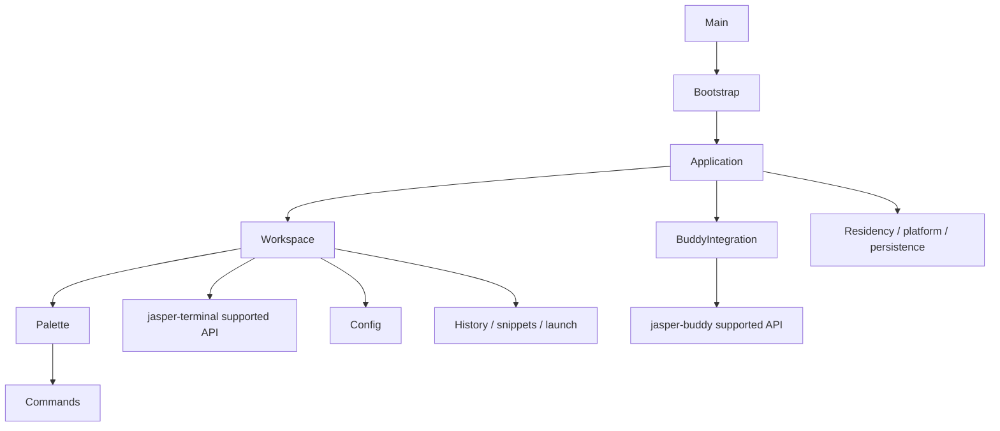

# Application and Buddy architecture

The app is the composition root for two independent libraries. The refactor preserves
user-visible terminal behavior and establishes clear owners for future features.
Plugins are hosted by `dev.jasper.app.plugins` against the separate `jasper-sdk`; see [SDK architecture](sdk-architecture.md).



This diagram names major collaborations; package-info files and the bytecode checks
record the full package DAG. Neither library imports the app or the other library.
App terminal use is restricted to the documented allowlist; no `internalAccess()` or
vendor emulator types cross the boundary. App Buddy use is restricted to its five
supported top-level types and nested values. Both package graphs must remain acyclic.

## Patterns chosen for actual work

The command registry joins real Swing actions, metadata, shortcuts and palette dispatch.
Immutable configuration builders preserve all untouched fields. Concrete coordinators
own startup, session admission and shutdown. Buddy has one facade over its bounded model
and lazy windows. Typed workspace events and JDK callbacks report upward without facade
back-references. PaletteScope has three real providers; no speculative interface or
emulator-backend abstraction was introduced.

App Java-public classes enable feature collaboration; they are not the plugin API. The
supported API is `jasper-sdk`, and only `dev.jasper.app.plugins` may reference it. Do not
infer SDK guarantees from Java visibility.

## Startup, lifetime and shutdown

```mermaid
sequenceDiagram
  participant Bootstrap as ApplicationBootstrap
  participant Resources as StartupResources
  participant App as JasperApplication
  participant Launches as SessionLaunchCoordinator
  participant Workspace
  participant Buddy as BuddyIntegration
  Bootstrap->>Bootstrap: Parse arguments / take the instance lock or hand off before AWT
  Bootstrap->>Resources: Own acquired configuration, logging, hooks
  Bootstrap->>App: Compose on EDT; transfer owners after wiring
  App->>Buddy: Configure one companion model; native show remains lazy
  App->>Workspace: Create window with immutable launch snapshot and callbacks
  Workspace->>Launches: ShellLauncher submits captured request
  Launches-->>Workspace: ShellLauncher delivers on EDT; pane rejects closed origin
  Bootstrap->>Resources: Transfer successful startup ownership
  Workspace-->>App: Pane/window activity and closure
  App->>Workspace: Quit closes panes and subscriptions
  App->>Launches: Stop admission; late returned sessions close
  App->>Buddy: Close notifier first, then companion and global listener
  App->>App: Close history/config/providers/native handlers/endpoint
  App->>App: ApplicationShutdown waits off EDT with bounded timeout
```

`StartupResources` rolls back reverse acquisition order once and suppresses cleanup
failures onto the original error. Pre-EDT and EDT composition use separate scopes.
One process owns each home: `bootstrap.SingleInstance` takes `residency.InstanceLock` (`daemon/instance.lock`) before
AWT and follows spec 5.2's table (`LaunchAction`). The owner binds the handoff endpoint and the command socket at once
(`bootstrap.Instance`) and holds requests in `EarlyRequests` until `compose` hands it the application; from then on it
answers a handoff only once the EDT has taken it (within a second), and none while it quits. Any other launch hands its
request (protocol 2: RAISE or OPEN_PATHS, its working directory, paths and ignored start-up flags) to the owner and
exits without creating a window; a `--background` or `--no-window` launch exits at once; restart's replacement
(`--replacing <pid>`) waits up to 30 s for the lock; an owner that does not answer within 10 s is reported
(`bootstrap.LaunchFailure`) and no second instance starts. A start that fails after taking the lock closes its
endpoints and exits, so the lock goes with the process. The owner records its process id in `daemon/instance.pid`
when it takes the lock, and on Windows a handing-off launcher lends
it Windows' foreground right (`platform.WindowsForeground`) before sending the request, so an existing window can be raised immediately. A settled resident Windows
process opts out of execution-speed throttling and keeps a soft working-set floor
(`platform.WindowsProcess`); each window's timing line reports how long Jasper had no
window and, on Windows, the page faults until the window was shown. Logging cleanup and final process waiting do not block Swing.

Plugins start once, before the first window. Shutdown arms an exit deadline first, closes
application-owned state, then stops plugins in reverse order; their drained background work
joins the bounded wait. A blocked EDT callback cannot be abandoned, so the deadline, not the
bounded wait, ends the process in that case.

A pane owns its admitted session. The launch coordinator stops admission and closes
late arrivals; it does not force-close a session before its pane has completed cleanup.
Shutdown waits for accepted launch workers, their late child exits, tracked process exits,
command-history flush and endpoint cleanup with the existing two-second bound. Endpoint
cleanup runs on daemon workers; both ordinary quit and startup rollback
queue this cleanup without blocking EDT. The two-second bound covers the application
wait, not a promise that every cleanup succeeds or the JVM exits within two seconds.
The process shutdown hook backs up endpoint cleanup and drains logging separately.

Windows are one main window and any number of child windows (workspace tabs spec 6), all made and closed by the
application's `WindowManager` (workspace): the main window has every piece of chrome around its workspace and keeps an
empty workspace when its last tab closes; a child window (`WindowRole.CHILD` content) shows a title bar over its
workspace and closes with its last tab. A child window is a full window, with parent tabs (the code's name for a window's
tabs; each group, a pane, holds one tab, its item). `WindowManager` moves a parent tab into a new full window and a full
window's parent tabs to the main window: `WindowContent.receive` lands each tab through the tab
registry, then, when every tab arrived, `WorkspaceView.rearrange` gives the parent tab its planned layout. Every outside request, a plugin's tab
with no window and the menu bar item
restore the main window first; closing the main window, Quit and going to the background close the child windows, then
the main window. `MainWindow`'s constructor has one call site, `WindowManager.ensureMain`, which
`verifyApplicationArchitecture` checks.

Residency retains indexes/config/history after the last window,
and does not intentionally retain pane sessions; asynchronous child cleanup may
briefly continue after the last window closes. On a packaged macOS Jasper that is
resident, Quit (`JasperApplication.quitRequested`) closes every window through the
windows' closing guards and keeps every owner (`toBackground`); `DockPresence` hides
Jasper from the Dock while no window is open and brings it back before the next window
is composed, through the injected `DockControl` (`platform.MacDock`). `quit()` asks the
plugin quit guards and then closes all owners. It is reached by Quit Jasper Completely in
the menu bar item and Quit Jasper in the Windows notification-area icon
(`platform.ResidentTray`, whose Windows icon also carries the system notifications'
balloons), the Plugin Manager's Quit Jasper button (shown when a restart
cannot be planned), an auxiliary window's File › Quit, and macOS logging out, restarting or shutting down; a restart asks the same
guards and then quits through `quitNow()`. Any Quit before start-up has settled, and any
Quit by a process that is not resident or has no Dock presence, quits the same way. The
indicator and the macOS bridge arrive once start-up has settled (the
first output painted, a finished `--background` warm-up, or 2 s after the first paint).
A reopen, or a launch of another build, with no window open relaunches the process when its
application jar changed on disk; the replacement waits for the lock. A `--background` launch rehearses one window (`application.Rehearsal`): composed
with a canned terminal and no shell, painted once into an image, disposed unseen; one explicit collection follows it.

## Threading and cancellation

Swing workspace, palette, theme subscriptions, notice producers and Buddy run on EDT.
Shell creation, bounded file reading and process waiting run on their existing workers.
The terminal library retains its own reader-thread/buffer-lock contract. Do not call
Swing synchronously while holding a terminal buffer lock.

Palette completion captures a generation, step, scope and origin. A queued callback
rechecks them after reaching EDT; dismissal, scope replacement or origin closure
invalidates it. WindowCommandPalette separately captures the pane/tab and requires
them to remain current in an active, open workspace. Completion guards prevent stale
UI publication; they do not undo provider work already submitted, such as a snippet
append. Subscriptions close once and detach from the actual owner.

Workspace OPENED precedes command events; app notification wiring registers opaque pane
IDs. CLOSED removes the active ID before timer cancellation and card dismissal. A saved delayed
callback or late finished event cannot resurrect that pane. There is no growing tombstone
set. App closes notifier before Buddy. Hiding Buddy retains its model and stops animation;
closing clears model closures and all presentation resources.

## Saved versus temporary configuration

`ConfigSnapshot` validates immutable canonical values; builder and toBuilder use that same
validation. `WorkspaceConfiguration` applies the saved window chrome (sizes, toolbar mode,
status bar) on every reload: the View menu saves those choices through `WindowContent.choose`
instead of keeping them per window, and a window without a configuration applies them directly.
`ConfigurationController` sends the appearance (`ui.appearance`, resolved against the operating system's) and `terminal.scheme` to `ThemeController`.

Existing terminal views copy current options before replacing configured fields, preserving
unrelated options and temporary font size when the saved size is unchanged. Live fields
include font, cursor, Option-as-Meta, copy-on-select and bell behavior; pane dimming and
shell-exit policy are updated separately. Scrollback capacity, shell command/arguments,
environment and integration mode are captured by `LaunchSettings` for each launch request.
The initial grid is captured once per window by `JasperApplication.windowLauncher`; a later
saved grid change applies to new windows. Scrollback capacity belongs to the session and
is not resized by applying view options. A pending pane receives the latest live view
configuration in `TabHost.configure` when its session arrives.

ThemeController publishes resolved values; platform title bars receive components and
callbacks. Application-level Buddy enablement, snippet reload and login-item reconciliation
are wired by JasperApplication. Residency is decided at startup, not changed by a reload.

## Package ownership

| Package | Owner and thread/lifetime contract |
| --- | --- |
| `root` | Stable launcher only; delegates to bootstrap. No owned resources. |
| `bootstrap` | Pre-AWT arguments, the home's instance lock and the handoff, and EDT composition. StartupResources owns rollback until explicit transfer; the owner's Instance keeps its lock for the life of the process. |
| `application` | EDT application composition and feature lifetimes; launch coordinator synchronizes admission and shutdown waits off EDT. JasperApplication closes children. |
| `workspace` | EDT windows (`WindowManager`, `MainWindow`, `ChildWindow`, their `WindowFrame`s), their parent tabs (`ParentTabsView`, with the parent-tab bar `ParentTabBar`), each a workspace of groups, its panes, one tab each (`WorkspaceView`, `GroupView`, `SplitContainer`), terminal tabs and panes, the tab and pane drag (`TabDrag`, the window manager's one, shared by its windows), the tool window area, stripes, headers and dock drag, action/config adapters, activity events, each window's presence in the terminal registry, and the pending and disconnected states of provided sessions, and the palette's homes (`PaletteHome`: `TitleFieldHome`, `UpperHome`, chosen by `WorkspaceChrome.of` from the look's `PaletteLook`). WindowContent closes subscriptions/panes; each pane closes its session. |
| `dock` | Pure tool window dock model: the six slots, each window's `DockState`, `DockGeometry` and the drag's `DockDropResolver`; and the tab and pane drag's `WorkspaceDropResolver`. JDK-only (no Swing; `java.awt.Rectangle` and `Point` only, and the layout's group ids and sides, enforced by `verifyApplicationArchitecture`); each window owns its state on the EDT. |
| `layout` | Pure workspace layout model: a window's parent tabs (`ParentTabs`, with the shown one and their order of use), parent tab, tab and group ids, a workspace's groups (its panes, one tab each) in nested weighted splits (`Layout`, `Split`, `Group`), its active and maximized group and the groups' order of use, the operations that return a new layout, and each group's region of the unit square with its directional neighbours. JDK-only (nothing from Swing or AWT, enforced by `verifyApplicationArchitecture`); immutable values, safe on any thread. `persistence.WorkspaceFile` reads and writes a workspace's `Layout` as `workspace.toml`. |
| `commands` | EDT action registry, pure command ranking/metadata and the palette's command recents (`command-history.toml`). Registry owns listeners until registration or registry close; the application flushes recents at shutdown. |
| `palette` | EDT scope/query/step state, keyboard routing, the palette's two views behind `PaletteView` (the card, `CardView`, and the Run window, `RunWindowView`, built by `PaletteViews.of` from the look's `PaletteLook`) and the built-in Commands scope. Controller owns scope listeners and invalidates asynchronous completions on close. History and Snippets are bundled plugins. |
| `config` | Immutable values and pure parsing through CoreSettings.SCHEMA; ConfigService owns background watch/reload, the save transaction (settings, shortcuts) and Migrate Config, and marshals delivery to EDT. Application closes the service. |
| `settingsui` | EDT Settings dialog: the shell, the draft of pending core-setting edits, schema-generated and group pages, editors and the core page tree; the application supplies the Keymap, Plugins and plugin tool pages (`CorePages.Pages`). SettingsDialog owns each opening's pages and disposes them on close. The look's `presentation.SettingsChrome` sets the frame (a native title, the collapsible navigation), Reset inline or in the row's menu, the rows the look implies and the font row's copy; every page's `PageContext` carries it with the `Composition` only the composition roots read. |
| `settings` | Pure declarative settings machinery: setting kinds, descriptors, the schema, loaded values and the comment-preserving TomlDocument editor. No Jasper dependencies; caller chooses thread. SchemaReader reads any settings file against its schema. |
| `contributions` | EDT model of what extensions contribute to the chrome, in app-native types, and the `TabRegistry` of every window's tabs, terminal and plugin. Application owns the single instance; the plugin runtime writes it, every window renders it and registers its tabs in it. |
| `appearance` | EDT theme resolution and global look-and-feel installation. Subscribers own returned cancellation handles. |
| `launch` | Immutable launch capture, shell profiles (WSL distributions, PowerShell 7, Command Prompt, the login shell, Custom) and shell integration extraction; ShellLauncher starts off EDT and delivers on EDT; the EDT-confined ShellProfileCatalog detects off EDT and is closed by the application. Receiving pane owns the session. |
| `terminals` | App-native registry of Jasper windows, their tabs (terminal and content) and terminal tabs' panes: pull-based entries, id-only events, the derived active pane, and the app-native session request and attempt state machine. Application owns the TerminalRegistry; each window closes its own registration. |
| `windows` | Application-built auxiliary windows and dialogs: a headless surface core and the only other native frame boundary besides WindowFrame. Application owns AuxiliaryWindows and closes it at shutdown. |
| `files` | Jasper's file chooser: the headless `ChooserModel` over `Location`s, `Browser`s and `ChooserSource`s (the local disk is `LocalSource`/`LocalBrowser`; plugin sources are adapted in `plugins`) and the Swing `FileChooserPanel`. NativeShells shows it in a dialog and owns that dialog's worker; the model applies worker results on the EDT, drops stale ones and closes the browsers it opened. |
| `notifications` | EDT notification center (groups, the in-memory history, read and expired state, delivery routing) and its values, the incident store with its captures and reports, plus terminal and activity notice production for Buddy. Application owns the center and the incidents and closes notifiers before companion. |
| `notificationui` | EDT Swing views of the center: the main window's CardLayer, the history panel, the Errors tab's ErrorsView, and their text, style and focus helpers. Application mounts each layer through WindowContent and closes it with its window; the Errors tab closes its view when it closes. |
| `about` | The About and Licenses windows' views and the third-party notices index read from resources. Application's AboutWindows owns both windows and closes each view with its window. |
| `splash` | The boot splash of a branded look: `SplashPainter` draws it from the look's files, the same in every theme, and `Splash` is its undecorated window, which every paint reaches as one copy from `SplashBuffer`. The bootstrap decodes the files off the EDT, opens the window on it and closes it through `StartupSteps` when the first window shows or start-up fails. |
| `residency` | The instance lock, the bounded handoff protocol and its endpoint worker. The lock lives as long as the process; bootstrap transfers endpoint close to application shutdown and process-hook backup. |
| `commandline` | The `jasper` command's side: the command socket's wire format and listener (a reader and a writer virtual thread per call; output is only queued), the calls it dispatches, the subcommand list `jasper --help` reads, and putting the command on `PATH`. The home's owner binds the listener before AWT and holds its calls until the application is composed; the application closes it at shutdown. |
| `platform` | OS adapters, icons, fonts, title-bar paint, logging and system notifications. Callers own registrations and native handles; Swing operations run on EDT, logging and system notifications each have their own worker, and the macOS title band reads the double-click setting once on a short-lived virtual thread. |
| `persistence` | Bounded TOML reads and atomic writes; synchronous helpers own short-lived file handles. Caller chooses thread and lifecycle. |
| `presentation` | The presentation a process runs with, chosen once before Swing: the kit file parser (`KitParser`, `ChromeSpec`, `FontFile`), each provider's `PresentationFacts`, the attempt record (`AttemptStore`, `PresentationAttempt`), the projections of spec 9.1 and `Presentation`. The window chrome's projections are read by the bootstrap (`DesktopFlags`), `WorkspaceChrome.of`, `ShellChrome.of`, `WindowLook`, `WindowTitle` (`TitleFormat`) and the application's `LookMotion`, and the dialog mapping by `AuxiliaryWindows`. Values and bounded file stores; `PluginSelection` builds it and the application hands each consumer its kit or projection. `Branding` holds a look's product name, icons and splash art as bytes; the bootstrap and `ApplicationIcon` decode them. |
| `plugins` | The plugin runtime: descriptors, locked consent state, resolution, per-plugin classloaders, the queued EDT event bus, activities, the service registry and plugin lifetimes. Application owns and stops PluginRuntime; it is the only package that may reference the SDK. Declared plugin settings (DeclaredSettings) are read with the plugin's own schema and saved through PluginSettingsFiles. PluginRuntime.settingsPages gives Settings a page per plugin under Tools. |
| `shortcuthelp` | The Settings dialog's Keymap page: effective shortcut catalog, expandable searchable sections, staged binding edits saved on Apply and a window-scoped key recorder; `KeymapPage` maps the look's composition to a `KeymapShape` (columns, text tools, the recording band). SettingsDialog owns each KeymapPage; disposing it closes its subscription and capture. |
| `pluginmanager` | The Settings dialog's Plugins page: passive view, consent view and an EDT controller over PluginRuntime's public records; `PluginsPage` maps the look's composition to a `PluginShape` (checkbox rows, ⋯ actions). Application owns the PluginManager; SettingsDialog owns each PluginsPage, whose consent and confirm dialogs open over Settings. |
| `restart` | Pure restart planning (the replacement waits for the lock with `--replacing`) and the Plugins page's restart banner state (`RestartFlow`). No owner. |
| `vmoptions` | Custom VM options: the launcher's reading of `jasper.vmoptions` mirrored for the app, editing it, the launch's properties, the bundled `Jasper.cfg`, the check that runs the bundled `java`, the record of a start-up cache that failed at launch, the heap readings and the low-memory watch with its heap threshold. JDK-only (`com.sun.management` allowed; `verifyApplicationArchitecture` enforces it); values and pure functions, with file I/O and the check on the caller's thread, and `HeapThreshold`, a resource its creator closes whose callback runs on the JMX notification thread. |
| `lifecycle` | Owner-thread-confined once-only cancellation. The subscriber closes the handle; no background worker or global state. |
| `startup` | Start-up timing (`StartupTrace`, `WindowTrace`, `StartupTraceFile`) and the steps a branded look's splash shows (`StartupSteps`); JDK-only, depended on by bootstrap, application, plugins, splash and benchmark. Safe from any thread except `StartupSteps` (EDT only); `mark` and `phase` are non-blocking and run on the caller's thread; settling, logging and file writes run on virtual threads, never on the EDT. |
| `benchmark` | Explicit opt-in native benchmark orchestration and reports. Benchmarks own and close fixtures; never part of headless check. |

Buddy's supported packages are `view`, `notice` and `config`; its internal model and
animation packages do not depend on presentation. Presentation depends on those pure
owners and values. The facade alone coordinates both. The full outgoing dependency
list is documented in each package-info file and verified from compiled bytecode.

## Resources and verification

Shell scripts keep their classpath paths. `ThemeManager.install` names `SplitDividerBorder` by class name, so it
must track package moves. Icons use absolute paths;
Buddy loads its sprite relative to BuddySprite in its own jar. Artifact tests open actual
jars, decode the PNG, resolve the configured divider class and reject test fixtures.

Run `./gradlew verifyTerminalArchitecture verifyApplicationArchitecture check :jasper-app:installDist`.
The terminal checker enforces its existing allowlist; the app/Buddy checker validates
all package edges and supported Buddy signatures. Neither uses cycle exemptions.
Javadoc and copied guide examples are normal check dependencies. See the
[verification report](app-refactor-verification.md) for current evidence and manual gaps.

## Window chrome

The main window has a header row above its parent tabs: the parent-tab bar, the window's one tab strip (in the standard look, none while the window holds a single parent tab), then the shown parent tab's workspace of groups, its panes; a child window has only its title bar, which ends with the window's ⋮, above its parent tabs. `WindowHeader` (workspace) centres
`TitleSearchField` on the window and packs `WindowChrome`'s IntelliJ-style toolbar (tab/window,
pane, plugin, then Find/Settings groups, then the window's ⋮, `WindowMenuButton`; tooltips carry live shortcuts) against the trailing edge.
The field is always centred on the window; the sides give way first (toolbar labels, then controls into
the overflow menu; on Windows and Linux the menus fold into "…" and then ☰), and only then does the field shrink
and collapse to its magnifier. `toolbar = "hidden"` hides only the buttons. `TitleBarStyle` (platform) is
chosen at startup: on macOS `MacTitleBar` hosts the header in the native title row and gives it insets
that keep clear of the traffic lights; on Windows and Linux FlatLaf's title pane embeds
`CollapsingMenuBar`, which carries the header under the menus; with `window.native_decorations = true`
the system title bar stays and the header is the top row of `WindowContent`. A look with a native title gives every
platform the system title bar. With `menu_bar = "window"` the bootstrap turns macOS's screen menu bar off, so the main
window's menus are a row in the window (a child window shows none, and an auxiliary frame shows none and binds Close
Window's shortcut itself). Otherwise, on macOS a focused child window's screen menu bar shows its own copy of the main
window's menus, built from the same model.

The Enterprise presentation's classic title (`title_bar = "classic"`) is IntelliJ Classic's:
- On macOS, `MacTitleBand` (platform) is a 28 pt band in the toolbar's colour under the system's transparent title,
  which macOS draws with the traffic lights; a child window has it too. The menus stay in the screen menu bar, and an
  auxiliary frame keeps its system title bar and shows the minimal File menu there.
- On Windows, FlatLaf's title pane embeds `CollapsingMenuBar` and `ClassicWindowTitle`, the window title left-aligned
  after the menus, over a 1 px rule. A child window's title pane is 28 px in the toolbar's colour and holds FlatLaf's
  title and the window's ⋮, dimmed while the window is inactive.
- On Linux it is the system title bar.

`TitleInset` keeps classic in-window dialogs and overlays below either, and below the FlatLaf title pane of a Windows
auxiliary frame or dialog under the classic title.

A native-titled macOS frame's appearance follows the theme; Jasper gives the
Windows and Linux system title bar no appearance hint (JBR has none). `WorkspaceChrome.of` (workspace) and
`ShellChrome.of` (windows) read the look's projections and choose the strategies, among them `MenuBarLayout`:
`StandardMenuBar`, or `ClassicMenuBar` (File, Edit, View, Session, Transfer, plugin menus, Tools, Window, Help).
`WindowTitle` fills the look's title template. `WorkspaceChrome.of` also picks the window content: `HeaderComposition`
(`UnifiedHeader`, or `ClassicHeader`, a toolbar row of left-packed buttons with the search field and Settings…
trailing), `TabStrip` (the parent-tab bar's: `WindowTabs`, or the content-sized `ClassicTabs`), `StatusCells` (`SlashSegments`, or
`RuledCells`) and the leading "▶ Run…" item. `AuxiliaryWindows` reads the look's dialog mapping and marks the surfaces
it makes; `NativeShells` draws a marked modal overlay or attached sheet whose window is showing in that window as a
`ClassicDialog`. The title search field shows `WindowHeaderContext` and opens the palette, which `WindowCommandPalette`
places through its `PaletteHome` (the field's bounds for the card). `WindowTabs` are IntelliJ editor tabs sized to content with a 3 px selection underline,
wheel scrolling and a ▾ list of all tabs. Each pane's `FindBar` is IntelliJ's single-line find row. App icons resolve
from bundled assets. Since SDK 0.7.6, plugin-supplied SVGs draw as authored and are no longer recoloured to the chrome
foreground (see [SDK architecture](sdk-architecture.md)).
The header, both stripes and the status bar are the native chrome's receiving contexts (`AppIcons.chromeReceiver`):
named glyphs painted inside them use the kit's original chrome artwork (`IconRegistry.chromeIcon`) without changing
icon values or identities, and their painting and text sizes come from `ChromePainter.installed()` and named kit roles.
Under `[chrome] icons = "classic"` each window's header and status bar are marked `ChromeArtwork.CLASSIC`, so the
meanings the classic set has draw IntelliJ's classic icons (`assets-classic.tsv`).
The labelled stripes and the bottom strip are not receivers: `DockChrome.stripes` gives them the look's
`ChromeArtwork`, and they draw each label's icon at 13 px through `AppIcons.stripeIcon`: under CLASSIC, IntelliJ's
classic tool-window icon where `IconRegistry.stripeIcon` has one, else the icon's monochrome glyph in the label's
ink; under NEW_UI, the icon the rails draw.

## Themes

The built-in themes are Slate Cobalt and Catppuccin's four flavours; installed themes are Jasper theme files in
`<home>/themes/` ([themes](themes.md)).
`ThemeManager.install(theme, kit)` installs a variant under the start-up kit through jasper-ui's `FlatLafInstaller`
(FlatLaf's IntelliJ-format input from the UI keys `UiColorKeys` derives from the theme's semantic roles, then the
`Jasper.semantic.*` role keys and the popup shadow, with the kit's geometry) and adds the app's native defaults: the
split divider border by class name and the centred title. The kit is published with the theme; app chrome reads it
through `FlatLafInstaller.installedKit()`, `ChromePainter.installed()` and `NativeStyles.installed()`.
Tool windows paint `surface.panel` (theme.md's tool-window body) through `ToolWindowSurface`, their headers included; the stripes stay chrome.
Under a look whose kit asks for stripes (`tool_windows = "stripes"`), `WorkspaceChrome.of` gives each window a
`DockChrome` with labelled stripes and flush frames: `StripeSet.LabelledStripes` puts two `LabelledStripe`s (labels
"N: Title" when the toggle's shortcut is a digit with a modifier) and a `BottomStrip` for the bottom slots in place of
the two `ToolStripe` rails, and `ToolWindowArea` divides the frames by painted 1 px rules with 6 px drag areas and gives
every frame a header strip, focused while it holds the focus owner. Dock geometry reads the window's kit.
`UiState` keeps such a look's dock under `[look."<provider id>"]`, and its Notifications panel is Event Log in the
bottom strip (`AppPanels`).

`JasperTheme` (jasper-ui) reads a theme file into one `GeneratedTheme` per variant and its terminal schemes;
`JasperTheme.bundled()` is Slate Cobalt, `builtIns()` every built-in theme. `appearance.ThemeLibrary` holds the built-in themes, the plugin themes (`PluginThemes`) and every valid
`<home>/themes/*.json`, reusing the parsed theme of an unchanged file, and keeps a problem for each file it skips.
`appearance.ThemeSelection` is the Dark and Light theme picks and the scheme choice from one library; its `of` replaces
a pick the library cannot honour by its default and reports it, silently for a disabled plugin's theme or scheme. `ThemeController.configure(dark, selection, font)`
installs the shown variant for chrome and workspace and resolves the scheme's palette for terminal panes
(`ResolvedTheme.of`); `ResolvedTheme.surface()`, the
workspace's `surface.terminal`, is what the window behind panes, tab backgrounds and the tab strip use, so a scheme
colours only the text area. `ConfigurationController` resolves `ui.appearance` with `AppearancePolicy` against the
live `SystemAppearance` observation and builds the selection from `ui.theme.dark`, `ui.theme.light` and
`terminal.scheme`. It reads the themes folder again through `ConfigService.watchWith` on the configuration worker,
before each forced or changed state is published, so Reload config, a Settings save or a `config.toml` change picks up
theme files. Skipped files, unusable picks and an installation failure are its theme problems, shown with the
configuration's diagnostics; an installation failure keeps the current appearance. Each window's `WindowCommands`
rebuilds the "Terminal: …" commands when the library changes. Plugins receive the roles and the editor scheme through
`plugins.HostedPalettes`.

## Hosted workspace styling

`WindowContent` publishes only the mounted root's app-owned WorkspaceTheme markers. Publication checks
the hosted entry identity between property writes, so synchronous removal/move callbacks cannot overwrite
the destination route. Unmount/close clears the markers. Kit views and specialized content own descendants;
there are no recursive styles, combo popup bridges or descendant observers. ToolWindowSurface colors only
the native shell; ToolWindowHeader reads its own module surface. Platform ThemeZone routes native paint and
PresentationIcon; immutable artwork snapshots and receiving registries retain the Task11a lifetime rules.

ThemeManager installs the module snapshot and only three app-native delegate settings: the kit's
NATIVE_SPLIT_DIVIDER metric, app SplitDividerBorder and centered native titles. SnapshotLaf republishes
module explicit/canonical colors when defaults are recreated, including reinstall and rollback. There is no
app palette fallback publisher, copied generator or AppListUI. Default raw-native text now follows the
canonical 13-point module baseline instead of the obsolete global12 override; explicit user fonts remain.

## Consumer migration completion

Plan 2 uses the kit as the only standard-control presentation authority. SDK 0.15 is incompatible with
pre-0.15 raw UI factories and raw presentation icons; all eight bundled manifests cut over together.
The [completion audit](design/theme-engine/completion.md) records exact gate scope, owner tests, headless
rendering, distribution checks and the named Plan 3 composition owners. App host Settings error/stub
content uses the dialog kit context and closes with its page; it is not covered by the plugin-only compiled gate.
