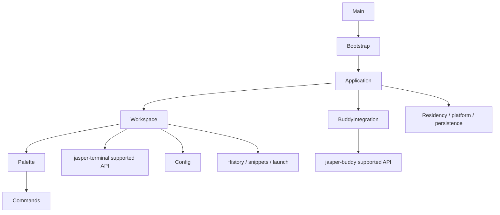

# Application and Buddy architecture

The app is the composition root for two independent libraries. The refactor preserves
user-visible terminal behavior and establishes clear owners for future features.
Plugins are hosted by `dev.jasper.app.plugins` against the separate `jasper-sdk`; see [SDK architecture](sdk-architecture.md).



This diagram names major collaborations; package-info files and the bytecode checks
record the full package DAG. Neither library imports the app or the other library.
App terminal use is restricted to the documented allowlist; no `internalAccess()` or
vendor emulator types cross the boundary. App Buddy use is restricted to its five
supported top-level types and nested values. Both package graphs must remain acyclic.

## Patterns chosen for actual work

The command registry joins real Swing actions, metadata, shortcuts and palette dispatch.
Immutable configuration builders preserve all untouched fields. Concrete coordinators
own startup, session admission and shutdown. Buddy has one facade over its bounded model
and lazy windows. Typed workspace events and JDK callbacks report upward without facade
back-references. PaletteScope has three real providers; no speculative interface or
emulator-backend abstraction was introduced.

App Java-public classes enable feature collaboration; they are not the plugin API. The
supported API is `jasper-sdk`, and only `dev.jasper.app.plugins` may reference it. Do not
infer SDK guarantees from Java visibility.

## Startup, lifetime and shutdown

```mermaid
sequenceDiagram
  participant Bootstrap as ApplicationBootstrap
  participant Resources as StartupResources
  participant App as JasperApplication
  participant Launches as SessionLaunchCoordinator
  participant Workspace
  participant Buddy as BuddyIntegration
  Bootstrap->>Bootstrap: Parse arguments / attempt resident handoff before AWT
  Bootstrap->>Resources: Own acquired configuration, logging, hooks
  Bootstrap->>App: Compose on EDT; transfer owners after wiring
  App->>Buddy: Configure one companion model; native show remains lazy
  App->>Workspace: Create window with immutable launch snapshot and callbacks
  Workspace->>Launches: ShellLauncher submits captured request
  Launches-->>Workspace: ShellLauncher delivers on EDT; pane rejects closed origin
  Bootstrap->>Resources: Transfer successful startup ownership
  Workspace-->>App: Pane/window activity and closure
  App->>Workspace: Quit closes panes and subscriptions
  App->>Launches: Stop admission; late returned sessions close
  App->>Buddy: Close notifier first, then companion and global listener
  App->>App: Close history/config/providers/native handlers/endpoint
  App->>App: ApplicationShutdown waits off EDT with bounded timeout
```

`StartupResources` rolls back reverse acquisition order once and suppresses cleanup
failures onto the original error. Pre-EDT and EDT composition use separate scopes.
A successful resident handoff creates no window. Endpoint bind failure cannot silently
leave a background process. Logging cleanup and final process waiting do not block Swing.

Plugins start once, before the first window. Shutdown arms an exit deadline first, closes
application-owned state, then stops plugins in reverse order; their drained background work
joins the bounded wait. A blocked EDT callback cannot be abandoned, so the deadline, not the
bounded wait, ends the process in that case.

A pane owns its admitted session. The launch coordinator stops admission and closes
late arrivals; it does not force-close a session before its pane has completed cleanup.
Shutdown waits for accepted launch workers, their late child exits, tracked process exits,
command-history flush and endpoint cleanup with the existing two-second bound. Endpoint
lock/probe cleanup runs on daemon workers; both ordinary quit and startup rollback
queue this cleanup without blocking EDT. The two-second bound covers the application
wait, not a promise that every cleanup succeeds or the JVM exits within two seconds.
The process shutdown hook backs up endpoint cleanup and drains logging separately.
Residency retains indexes/config/history after the last window,
and does not intentionally retain pane sessions; asynchronous child cleanup may
briefly continue after the last window closes. Quit closes all owners.

## Threading and cancellation

Swing workspace, palette, theme subscriptions, notice producers and Buddy run on EDT.
Shell creation, bounded file reading and process waiting run on their existing workers.
The terminal library retains its own reader-thread/buffer-lock contract. Do not call
Swing synchronously while holding a terminal buffer lock.

Palette completion captures a generation, step, scope and origin. A queued callback
rechecks them after reaching EDT; dismissal, scope replacement or origin closure
invalidates it. WindowCommandPalette separately captures the pane/tab and requires
them to remain current in an active, open workspace. Completion guards prevent stale
UI publication; they do not undo provider work already submitted, such as a snippet
append. Subscriptions close once and detach from the actual owner.

Workspace OPENED precedes command events; app notification wiring registers opaque pane
IDs. CLOSED removes the active ID before timer cancellation/orphaning. A saved delayed
callback or late finished event cannot resurrect that pane. There is no growing tombstone
set. App closes notifier before Buddy. Hiding Buddy retains its model and stops animation;
closing clears model closures and all presentation resources.

## Saved versus temporary configuration

`ConfigSnapshot` validates immutable canonical values; builder and toBuilder use that same
validation. `WorkspaceConfiguration` applies the saved window chrome (sizes, toolbar mode,
status bar) on every reload: the View menu saves those choices through `WindowContent.choose`
instead of keeping them per window, and a window without a configuration applies them directly.
`ConfigurationController` sends appearance, including `terminal.colors`, to `ThemeController`.

Existing terminal views copy current options before replacing configured fields, preserving
unrelated options and temporary font size when the saved size is unchanged. Live fields
include font, cursor, Option-as-Meta, copy-on-select and bell behavior; pane dimming and
shell-exit policy are updated separately. Scrollback capacity, shell command/arguments,
environment and integration mode are captured by `LaunchSettings` for each launch request.
The initial grid is captured once per window by `JasperApplication.windowLauncher`; a later
saved grid change applies to new windows. Scrollback capacity belongs to the session and
is not resized by applying view options. A pending pane receives the latest live view
configuration in `WindowContent.configurePane` when its session arrives.

ThemeController publishes resolved values; platform title bars receive components and
callbacks. Application-level Buddy enablement, snippet reload and login-item reconciliation
are wired by JasperApplication. Residency is decided at startup, not changed by a reload.

## Package ownership

| Package | Owner and thread/lifetime contract |
| --- | --- |
| `root` | Stable launcher only; delegates to bootstrap. No owned resources. |
| `bootstrap` | Pre-AWT argument/handoff flow and EDT composition. StartupResources owns rollback until explicit transfer. |
| `application` | EDT application composition and feature lifetimes; launch coordinator synchronizes admission and shutdown waits off EDT. JasperApplication closes children. |
| `workspace` | EDT windows, tabs, splits, panes, panel regions and the rail, action/config adapters, activity events, each window's presence in the terminal registry, and the pending and disconnected states of provided sessions. WindowContent closes subscriptions/panes; each pane closes its session. |
| `commands` | EDT action registry, pure command ranking/metadata and the palette's command recents (`command-history.toml`). Registry owns listeners until registration or registry close; the application flushes recents at shutdown. |
| `palette` | EDT scope/query/step state, keyboard routing, the Swing palette popup and the built-in Commands scope. Controller owns scope listeners and invalidates asynchronous completions on close. History and Snippets are bundled plugins. |
| `config` | Immutable values and pure parsing through CoreSettings.SCHEMA; ConfigService owns background watch/reload, the save transaction (settings, shortcuts) and Migrate Config, and marshals delivery to EDT. Application closes the service. |
| `settingsui` | EDT Settings dialog: the shell, the draft of pending core-setting edits, schema-generated and group pages, editors and the core page tree; the application supplies the Keymap, Plugins and plugin tool pages (`CorePages.Pages`). SettingsDialog owns each opening's pages and disposes them on close. |
| `settings` | Pure declarative settings machinery: setting kinds, descriptors, the schema, loaded values and the comment-preserving TomlDocument editor. No Jasper dependencies; caller chooses thread. SchemaReader reads any settings file against its schema. |
| `contributions` | EDT model of what extensions contribute to the chrome, in app-native types. Application owns the single instance; the plugin runtime writes it and every window renders it. |
| `appearance` | EDT theme resolution and global look-and-feel installation. Subscribers own returned cancellation handles. |
| `launch` | Immutable launch capture, shell profiles (WSL distributions, PowerShell 7, Command Prompt, the login shell, Custom) and shell integration extraction; ShellLauncher starts off EDT and delivers on EDT; the EDT-confined ShellProfileCatalog detects off EDT and is closed by the application. Receiving pane owns the session. |
| `terminals` | App-native registry of terminal windows, tabs and panes: pull-based entries, id-only events, the derived active pane, and the app-native session request and attempt state machine. Application owns the TerminalRegistry; each window closes its own registration. |
| `windows` | Application-built auxiliary windows and dialogs: a headless surface core and the only other native frame boundary besides TerminalWindow. Application owns AuxiliaryWindows and closes it at shutdown. |
| `files` | Jasper's file chooser: the headless `ChooserModel` over `Location`s, `Browser`s and `ChooserSource`s (the local disk is `LocalSource`/`LocalBrowser`; plugin sources are adapted in `plugins`) and the Swing `FileChooserPanel`. NativeShells shows it in a dialog and owns that dialog's worker; the model applies worker results on the EDT, drops stale ones and closes the browsers it opened. |
| `notifications` | EDT terminal and activity notice production, active producer identities, attention and visibility policy. Application closes notifiers before companion. |
| `residency` | Bounded interprocess protocol and endpoint workers. Bootstrap transfers endpoint close to application shutdown and process-hook backup. |
| `platform` | OS adapters, icons, fonts, title-bar paint and logging. Callers own registrations and native handles; Swing operations run on EDT and logging has its own worker. |
| `persistence` | Bounded TOML reads and atomic writes; synchronous helpers own short-lived file handles. Caller chooses thread and lifecycle. |
| `plugins` | The plugin runtime: descriptors, locked consent state, resolution, per-plugin classloaders, the queued EDT event bus, activities, the service registry and plugin lifetimes. Application owns and stops PluginRuntime; it is the only package that may reference the SDK. Declared plugin settings (DeclaredSettings) are read with the plugin's own schema and saved through PluginSettingsFiles. PluginRuntime.settingsPages gives Settings a page per plugin under Tools. |
| `shortcuthelp` | The Settings dialog's Keymap page: effective shortcut catalog, expandable searchable sections, staged binding edits saved on Apply and a window-scoped key recorder. SettingsDialog owns each KeymapPage; disposing it closes its subscription and capture. |
| `pluginmanager` | The Settings dialog's Plugins page: passive view, consent view and an EDT controller over PluginRuntime's public records. Application owns the PluginManager; SettingsDialog owns each PluginsPage, whose consent and confirm dialogs open over Settings. |
| `themeimport` | Offline bounded conversion, deterministic vendoring, frozen import plans and locked file operations. Startup owns resumable legacy migration; no config/application dependency. |
| `themesui` | Canned terminal preview for the forthcoming Themes page; EDT owner closes its fake transport and view. |
| `restart` | Pure restart planning, the ResidentControl seam and the RestartFlow state machine. No owner; worker threads are daemons. |
| `lifecycle` | Owner-thread-confined once-only cancellation. The subscriber closes the handle; no background worker or global state. |
| `benchmark` | Explicit opt-in native benchmark orchestration and reports. Benchmarks own and close fixtures; never part of headless check. |

Buddy's supported packages are `view`, `notice` and `config`; its internal model and
animation packages do not depend on presentation. Presentation depends on those pure
owners and values. The facade alone coordinates both. The full outgoing dependency
list is documented in each package-info file and verified from compiled bytecode.

## Resources and verification

Theme files and shell scripts keep their classpath paths. `ThemeManager.APP_DEFAULTS` names
`SplitDividerBorder` by class name, so it must track package moves. Icons use absolute paths;
Buddy loads its sprite relative to BuddySprite in its own jar. Artifact tests open actual
jars, decode the PNG, resolve the configured divider class and reject test fixtures.

Run `./gradlew verifyTerminalArchitecture verifyApplicationArchitecture check :jasper-app:installDist`.
The terminal checker enforces its existing allowlist; the app/Buddy checker validates
all package edges and supported Buddy signatures. Neither uses cycle exemptions.
Javadoc and copied guide examples are normal check dependencies. See the
[verification report](app-refactor-verification.md) for current evidence and manual gaps.

## Window chrome

Every window has a header row and `WindowTabs` below it. `WindowHeader` (workspace) centres
`TitleSearchField` on the window and packs `WindowChrome`'s IntelliJ-style toolbar (tab/window,
pane, plugin, then Find/Settings groups; tooltips carry live shortcuts) against the trailing edge.
The field is always centred on the window; the sides give way first (toolbar labels, then controls into
the ⋮ menu; on Windows and Linux the menus fold into "…" and then ☰), and only then does the field shrink
and collapse to its magnifier. `toolbar = "hidden"` hides only the buttons. `TitleBarStyle` (platform) is
chosen at startup: on macOS `MacTitleBar` hosts the header in the native title row and gives it insets
that keep clear of the traffic lights; on Windows and Linux FlatLaf's title pane embeds
`CollapsingMenuBar`, which carries the header under the menus; with `window.native_decorations = true`
the system title bar stays and the header is the top row of `WindowContent`. The field shows `WindowHeaderContext` and opens the palette, which
`WindowCommandPalette` anchors to the field's bounds. `WindowTabs` are IntelliJ editor tabs sized
to content with a 3 px selection underline, wheel scrolling and a ▾ list of all tabs. Each pane's
`FindBar` is IntelliJ's single-line find row. App icons resolve from bundled assets. Since SDK
0.7.6, plugin-supplied SVGs draw as authored and are no longer recoloured to the chrome
foreground (see [SDK architecture](sdk-architecture.md)).

## Themes

Every theme is generated into IntelliJ-format keys (resources under `dev/jasper/app/themes/`) and installed by one
path in `ThemeManager`:
1. `ThemeLoader` resolves the `parentTheme` chain (parent entries first, the child's replacing
   them in its order, so FlatLaf's in-order wildcards match IntelliJ's precedence), resolves the
   `colors` table and drops IntelliJ implementation classes.
2. FlatLaf's `IntelliJTheme` builds the look and feel with `ThemeManager.APP_DEFAULTS` (form
   typography, split divider) as extra defaults.
3. The manager puts back the explicit colours FlatLaf skips (IntelliJ-only namespaces such as
   `SearchEverywhere.*`, `EditorTabs.*`, `ToolWindow.*`, `StatusBar.*`).
4. `ChromeKeys` fills each `Jasper.*` chrome key the theme did not set from IntelliJ keys, with
   contrast floors for derived text.

Restored and derived keys are also recorded as the instance's extra defaults, so a rollback to it
keeps them. Every theme is generated from a Jasper theme document (`ThemeToml` → `ThemeResolver` for `extends` →
`ThemeGenerator`): the cursor, selection and bright colours (background, foreground, accent and the eight normal
colours are required), the 48 tokens and the syntax roles are derived with contrast floors, and
`UiTemplate` maps tokens onto FlatLaf, IntelliJ and `Jasper.*` keys under the theme's own `[ui]` keys. The generated
keys install through the IntelliJ path above. The four classic singleton built-ins are `Theme.DARK` (`themes/jasper-dark.toml`),
`Theme.JASPER_LIGHT` (`themes/jasper-light.toml`), and `Theme.INTELLIJ_LIGHT` and `Theme.DARCULA`, converted from the
vendored IntelliJ files by `IntellijConversion` as `ui_complete` documents (their own keys install unchanged).
Side panels paint `ToolWindow.background` through `ToolWindowSurface`; the rail stays chrome.

Native themes come from `ThemeCatalog`: user TOML files beside the actual config, then the indexed offline
collection. `Theme.Source` permits only `Bundled` and `UserFile`. The index loads lazily and reuses the four classic
singletons. Native inheritance, filename precedence, per-file diagnostics and unchanged-instance reuse remain.

`themeimport` owns the shared bounded converters (`ThemeConverter`, `ThemeArchive`, `ThemeLoader`, `EditorScheme`,
`SafeXml`), deterministic offline generation, safe file/import operations and resumable migration. It depends on
appearance, never config/application. JSON/XML parent resources live under `themeimport/intellij/`; XML forbids
DOCTYPE/external entities. `ThemeTomlWriter` preserves ordered UI and icon data and syntax styles without choosing
an OS or installing a LAF. Only the in-memory FlatLaf adapter supplies JSON at runtime.

`application.ThemeUpgrade` joins `themeimport.ThemeMigration` and `config.ThemeSelectionMigration` before
`ConfigService` construction, after help and resident handoff. A bounded journal persists original identity/hash,
output intent/progress, old-slot owners and exact config before/after values. All output is staged before originals
move, preserving local-parent dependencies across crashes. Atomic no-clobber publication and identity checks retain
foreign/edited files. Config intent prevents repeated chained renames after a post-write crash; completion follows
successful config handling. Recoverable source failures remain diagnostics after the completion marker.

The configuration worker rescans the native catalog and refreshes migration diagnostics without conversion.
`ConfigurationController` retains those separately from transient warnings; chrome and workspace both resolve in
the same native catalog. Settings keeps Appearance and Font & Colors, with `match`, until the Plan 5 Themes page.
`themesui.SampleTerminal` is the reusable canned preview and never launches a shell.

## Hosted workspace styling

`WindowContent` owns one `WorkspaceStyler` per mounted plugin center pane. `WorkspaceStyles` describes verified
FlatLaf 3.7 control recipes; `WorkspaceStyleLayer` composes generated styles beneath plugin class and inline
styles and reversibly owns direct fallback setters. The application keeps one chrome LAF. Before a chrome delegate
rebuild, host layers release generated state; afterwards they rebase defaults and reapply the latest workspace.
In match mode generated values and combo overrides are removed while observation remains for later independent use.

The EDT-owned tree styler observes dynamic children and associated table headers/combo editors by identity, stops
at chrome/exempt/popup boundaries, and styles only a combo's own dropdown popup. An excluded associated header/editor
retains one source-owned hierarchy listener to detect a return to eligible ancestry; no generated styles or general
property/container listeners remain on it. Removal, pane moves, plugin stop, and window disposal close layers,
listeners, popup overrides and queued work. No static component registry is used.

Mount acquisition rolls back partially published markers/styles if construction fails. Failed content opens leave
no ghost registry entry; failed moves restore the source or another main host when available. If neither can mount,
the live document remains explicitly unmounted and reopening the same key retries that entry without discarding edits.
Synchronous zone callbacks can move/dispose a pane, so publication validates ownership before continuing.

Editor syntax area, viewport and gutter are exempt; the outer scroll pane, scrollbars, banners and Vim bar remain
eligible. Bundled renderers and custom borders use the SDK's mounted-owner lookup; Vim's error/bell maps are plugin
inline styles and outrank generated values. The host sees only app-native tokens and JDK client properties. The
[plugin authoring audit](plugin-authoring.md#hosted-pane-control-styling) records domain colors and the delegate-owned
progress text limitation. Native visual acceptance remains a user-only check.
