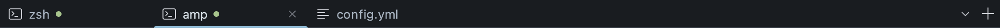
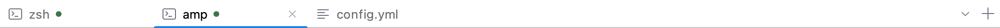

# Flat workspace tabs

> Superseded on 2026-10-05 by [Alacritty-style tabs](alacritty-tabs.md).

Approved in chat on 2026-10-04 from the user's supplied mock. This bounded visual follow-up supersedes
[folder tabs](folder-tabs.md): one flat workspace-colored strip, a subtle bottom separator, icons on
all tabs, muted inactive labels, and a full-width two-pixel accent underline with rounded upper corners.
Hosted tabs without supplied artwork use a generic document icon.
Close stays visible on the selected tab and appears on hover elsewhere. The tab-list dropdown and
new-tab plus stay fixed at the right. Colors come from the workspace palette, including its accent,
separator (`BORDER`) and session status (`SUCCESS`). The existing workspace frame owns outer corners.

A green dot after a terminal title means its focused session is running. Pending/failed/exited sessions
and hosted document tabs have no dot. Inactive running terminals retain their dot. Terminal labels
reserve space for it across launch/exit, and truncated titles leave it visible. The select button
exposes “Session running” to accessibility clients. No new status model or plugin API is introduced.

The 160–240 logical-pixel tab sizing and configured height remain. Terminal width measurements include
the reserved status space. The existing 80 ms open, 100 ms close and 130 ms switch motion now animates
the underline; resource disposal and selection remain immediate. The global animations toggle,
keyboard shortcuts, mouse selection, close, reorder, literal tooltips and overflow retain their paths.
The whole strip shares workspace glass opacity; opaque separator, underline and overflow fades remain
stable across partial child repaints.

Implementation stays in the app workspace package. This uses the approved bounded inline workflow
with one independent final review, rather than executing historical tab plans. No new implementation
plan is needed. Validation covers session-dot lifecycle, document/inactive/truncated labels, geometry,
scaling, themes, glass repaint stability, overflow and existing motion/interaction regressions.

## Headless previews

Run `./gradlew -I tools/previews/flat-tabs.gradle :jasper-app:flatTabsPreview`.
Outputs go to `jasper-app/build/flat-tabs-preview/` with dark/light first, middle, document and overflow
selection plus mixed chrome/workspace and glass examples. The fixture uses controlled `/bin/sh`
processes; it does not open a native window or the user's login shell.

Run the geometry suite at 2× UI scale with:
`./gradlew -I tools/previews/flat-tabs.gradle :jasper-app:test -Pjasper.tabTestScale=2 --tests '*FolderTabScaleTest'`.
Native desktop appearance and motion acceptance remain user-run.
