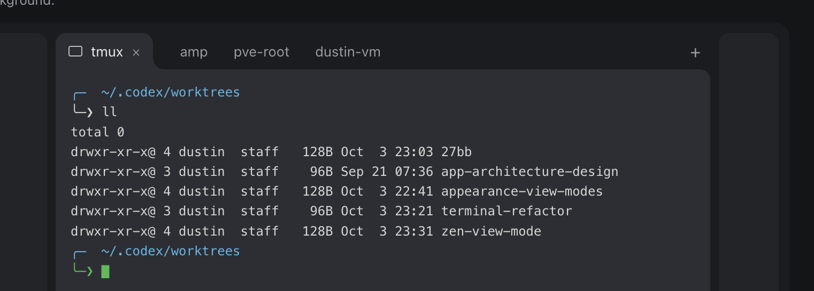
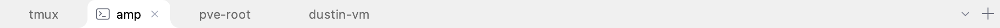

# Folder tabs

The user approved this visual follow-up on 2026-10-04 after reviewing an interactive mock over the application screenshot. The supplied reference below is the visual authority for the silhouette. This supersedes the inset rounded selection with a blue outline; the earlier Inset rail proposal remains a design alternative, not an application setting.

The selected tab rises out of the workspace surface, with rounded top corners and broad concave bottom shoulders. Its bottom edge joins the terminal surface without an outline or underline. Following the user’s native screenshot correction on 2026-10-04, the tab fills the entire rail height with no top inset, and its upper corners share the workspace frame’s 8-pixel radius (scaled with the UI); the bottom shoulders retain their broader curve. Inactive tabs are quiet labels. The active tab shows its session or plugin icon and close button; hovering an inactive tab reveals its close control. Tabs stay compact and content-sized. A new-tab button sits at the right of the strip, beside access to the existing tab list.

Use the actual workspace background for the selected surface, including the effective glass opacity. The recessed area around the folder remains solid; its color and readable text/icon colors derive from the active workspace appearance. Chrome and workspace themes remain independent. Preserve configurable tab height, wheel overflow, keyboard selection, middle-click close, context menus, drag reordering, plugin tabs, and literal bounded titles/tooltips.

This is a bounded change to the current Jasper workspace tab strip, based on `main` at `5979c030`. The initially attached worktree was still at the historical Moray readiness revision; the clean worktree was moved to the current application before implementation. The earlier tab-motion plans describe superseded code; that initial follow-up preserved current interactions without adding animation or settings. The subsequent motion extension below was explicitly approved by the user.

## Implementation preview

Headless renders from the actual Swing tab strip at 2× device scale:

## Native acceptance

Headless renders and tests cover the implementation. The user should confirm the shape on a physical display, including the first and a middle selected tab, dark/light workspace themes, translucent workspaces, short and long titles, overflow, plugin tabs, and the new-tab button. No unattended GUI or benchmark is part of this change.

## Tab motion and shared animation setting

Approved on 2026-10-04: opening expands and fades in (initially 150 ms), closing fades out while the gap contracts (120 ms), and selection glides the folder highlight (130 ms). Content and keyboard focus switch immediately. Motion uses short easing with no bounce, and rapid actions retarget the visible state instead of queuing transitions. Closing content releases its session/plugin resources immediately; the exit visual does not extend that lifetime. The full-height folder geometry remains unchanged.

Settings → Appearance → Animations has an **Enable animations** checkbox, enabled by default. The saved `ui.animations.enabled` value is the app-wide policy; future animation consumers must consult `ConfigSnapshot.animations().enabled()` and settle active transitions when configuration disables motion. This change does not audit unrelated animations. Turning motion back on affects subsequent actions and does not replay earlier actions.

At the user's request, **Open tab duration**, **Close tab duration**, and **Switch tab duration** are temporary tuning controls in the same section. Enter milliseconds and click Apply to try the new values without restarting. Values range from 0 to 2000; zero makes that transition instant. These save as `ui.animations.tab_open_ms`, `tab_close_ms`, and `tab_switch_ms`. Defaults are grouped in `AnimationSettings`; after native testing establishes the final values, remove the temporary tuning controls and retain the shared on/off policy.

Headless checks should cover midpoints and completion, interrupted transitions, immediate content/focus and resource cleanup, live disabling, zero durations, timer disposal, overflow and glass alpha. Final motion feel is a user-run native acceptance check; no unattended GUI launch is authorized.
