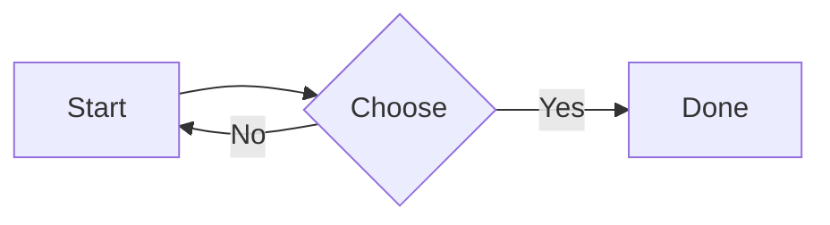
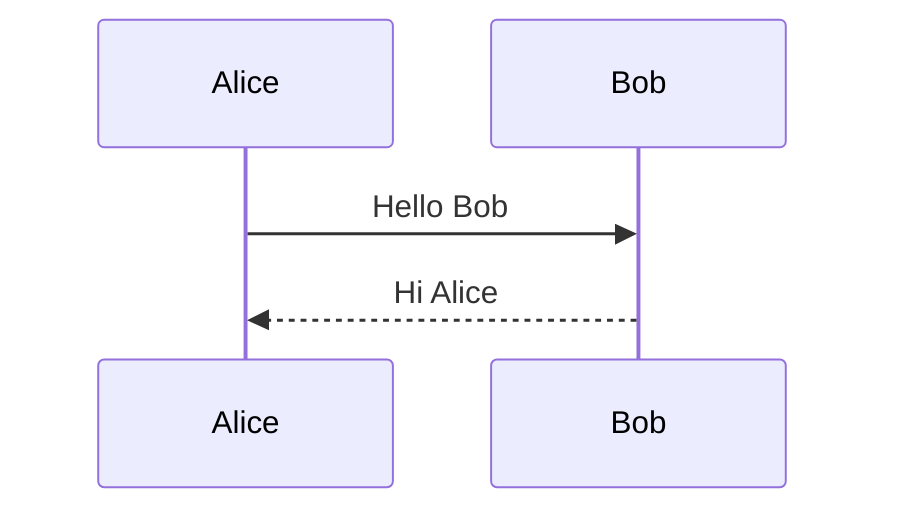
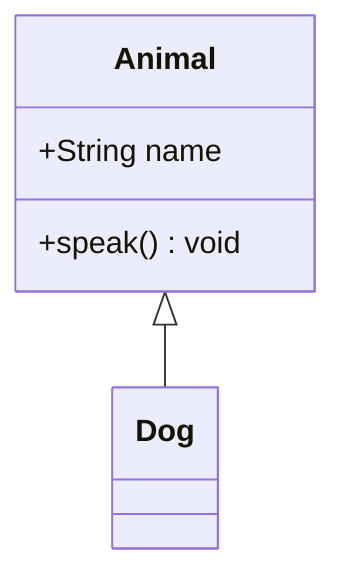
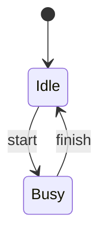
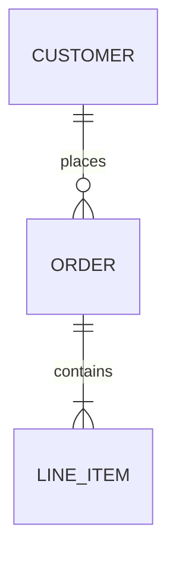
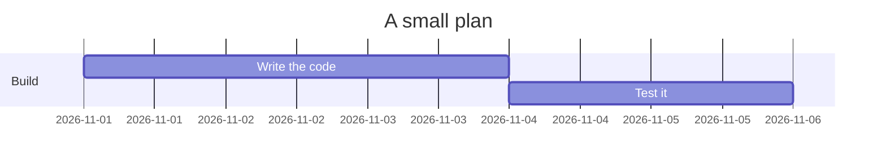
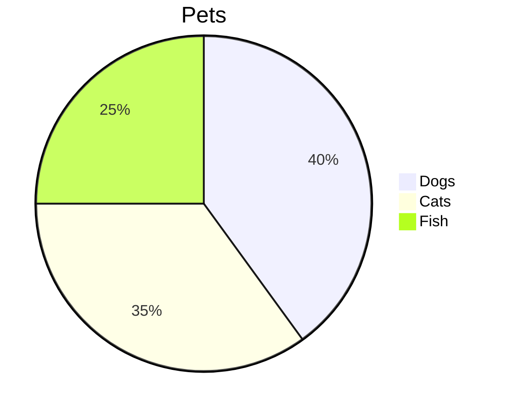
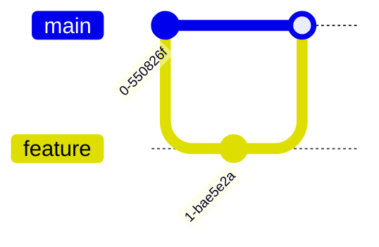
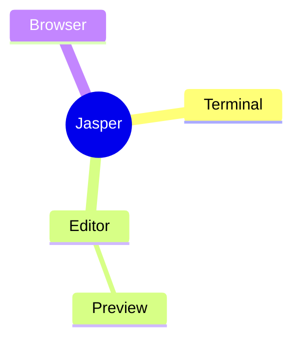

# GitHub features

Every construct the Markdown preview draws, in one file. Open it in Preview, then in Split.

## Text

Plain prose with *emphasis*, **strong text**, ~~struck text~~ and `inline code`.
A soft line break joins this line to the one before.
A hard line break ends this line\
and this one starts below it.

Raw HTML stays text: <kbd>Ctrl</kbd> and <span title="x">a span</span>. <!-- This comment is left out. -->

<!-- A comment on its own is left out too. -->

---

## Links and images

- A web link: [Jasper on example.com](https://example.com/jasper).
- A heading in this file: [jump to the tables](#tables).
- A relative file: [the everyday sample](everyday.md), and one with a heading: [its quote](everyday.md#a).
- Autolinks: https://example.com/autolink, www.example.org and <https://example.com/angle>.
- An email address: someone@example.com.

A relative image: 

A web image, shown only after Load external images: 

## Quotes

> A quote with **strong text**.
>
> > A nested quote.

## Alerts

> [!NOTE]
> Useful information that users should know, even when skimming.

> [!TIP]
> Helpful advice for doing things better or more easily.

> [!IMPORTANT]
> Key information users need to achieve their goal.

> [!WARNING]
> Urgent info that needs immediate user attention to avoid problems.

> [!CAUTION]
> Advises about risks or negative outcomes of certain actions.

## Lists

- A bullet item
- Another, with a nested list:
  - nested one
  - nested two

3. An ordered list that starts at three
4. and counts on

- [x] A finished task
- [ ] A pending task

* A loose list item.

* Another, separated by a blank line.

## Tables

| Left | Center | Right | Plain |
| :--- | :----: | ----: | ----- |
| one | two | 3 | `code` |
| **four** | *five* | 6.0 | [link](https://example.com/table) |

## Code

```java
/* A Java block. */
public final class Greeting {
    @Override public String toString() { return "Hello, " + 42; }
}
```

```python
# A Python block.
def greet(name: str) -> str:
    return f"Hello, {name}" if name else None
```

```yaml
# A YAML block.
name: jasper
versions: [1, 2.5, true]
```

```
A block with no language

keeps its blank line.
```

```not-a-language
Text in an unknown language stays plain.
```

    An indented code block.

```text
A wide line that scrolls sideways: 0123456789 0123456789 0123456789 0123456789 0123456789 0123456789 0123456789 0123456789 0123456789 0123456789
```

## Footnotes

A footnote reference[^first], a second one[^second], and the first again[^first].

[^first]: The first footnote, defined in the middle of the document.

The paragraph after a definition keeps its place in scroll sync.

[^second]: The second footnote has two paragraphs.

    Its second paragraph is indented.

[^unused]: A definition that nothing references is left out.

## Diagrams



















```mermaid
flowchart LR
    A -->
    this is not a diagram
```

## The end

The last paragraph.
